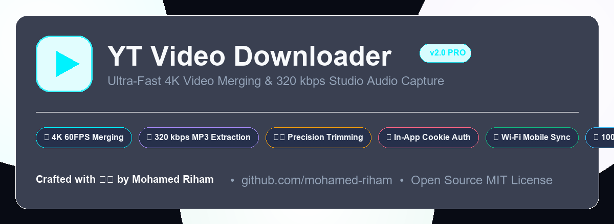

<div align="center">



# 🎬 YT Video Downloader

**An ultra-fast, local-first YouTube media capture utility built with Python 3.10+, Streamlit, yt-dlp, and modern FFmpeg.**

[](https://www.python.org/)
[](https://streamlit.io/)
[](https://github.com/yt-dlp/yt-dlp)
[](https://ffmpeg.org/)
[](LICENSE)
[](https://github.com/mohamed-riham)

[⚡ 1-Click Launch](#-1-click-quick-start-windows) • [💎 Features](#-features) • [🍪 Cookie Authentication](#-cookie-authentication--bot-bypass) • [📱 Mobile Sync](#-instant-mobile-sync-wi-fi) • [🏗️ Architecture](#️-architecture--project-structure) • [👨‍💻 Creator](#-creator)

</div>

---

## 💎 Features

- ⚡ **Full Quality Video Downloads:** 4K 60FPS, 1440p, 1080p Full HD, 720p HD merged automatically with modern FFmpeg.
- 🎵 **High-Fidelity Audio Extraction:** 320 kbps MP3, 256 kbps, 192 kbps, or original M4A/Opus with embedded cover art and metadata tags.
- 📋 **Batch Queue Processing:** Paste multiple video and playlist links at once to queue transfers simultaneously.
- ✂️ **Precision Range Trimming:** Specify custom `Start Time` (e.g. `00:01:30`) and `End Time` to download only the exact highlight clip.
- 💬 **Subtitles & Closed Captions:** Choose languages, download subtitle files, or embed `.srt` directly into the MP4 container.
- 🍪 **In-App Cookie Guide:** Seamless bot verification bypass via 1-click Firefox detection or direct Netscape `cookies.txt` upload.
- 📱 **Instant Wi-Fi Mobile Sync:** Scan a QR code on your local network to monitor queues and download finished media straight to your phone.
- 📜 **Download History & Library:** Instant search, sort by file size or date, filter by media type, and export complete logs to CSV.
- 🎨 **Modern Glassmorphism UI:** Multi-layered ambient lighting, 7 vibrant neon accent colors, dark/light theme toggles, and zero clutter.
- 🔒 **100% Local & Private:** Runs entirely on your computer (`~/.yt-video-downloader/`). No accounts, no telemetry, no cloud relays.

---

## ⚡ 1-Click Quick Start (Windows)

No command prompt required. Just run:

1. **Extract the ZIP file** to any folder on your PC.
2. Double-click:
   ```cmd
   ▶ START_DOWNLOADER.bat
   ```
   *(or `START.bat`)*
3. **On first launch**, the script automatically creates an isolated Python virtual environment, installs dependencies, and checks for FFmpeg & Deno in ~1 minute.
4. Your default web browser will automatically open:
   ```
   http://localhost:8501
   ```
5. On all future launches, it boots instantly in 2 seconds!

---

## 💻 Developer / Manual Setup

If you prefer installing and running manually via terminal:

### 1. Clone the repository
```bash
git clone https://github.com/mohamed-riham/yt-video-downloader.git
cd yt-video-downloader
```

### 2. Create and activate a virtual environment
```bash
# Windows (PowerShell)
python -m venv .venv
.\.venv\Scripts\Activate.ps1

# Linux / macOS
python3 -m venv .venv
source .venv/bin/activate
```

### 3. Install dependencies
```bash
pip install -r requirements.txt
```

### 4. Ensure FFmpeg is available
- **Windows:** `winget install Gyan.FFmpeg`
- **macOS:** `brew install ffmpeg`
- **Linux:** `sudo apt install ffmpeg`

### 5. Launch the application
```bash
streamlit run app.py
```

---

## 🍪 Cookie Authentication & Bot Bypass

YouTube periodically requires user verification for high resolutions (4K) or age-restricted content:

| Method | Supported Browsers | Setup Instructions |
| :--- | :--- | :--- |
| **Method A (Recommended)** | 🦊 **Mozilla Firefox** | 1. Sign in to YouTube on Firefox.<br>2. Close Firefox completely.<br>3. In App Settings, select **Firefox** under *Read Cookies From Browser* and click **Save**. |
| **Method B (Universal)** | 🌐 **Chrome, Edge, Brave, Opera, Vivaldi** | 1. Install [Get cookies.txt LOCALLY](https://chromewebstore.google.com/detail/get-cookiestxt-locally/cclelndahbckbenkjhflpdbgdldlbecc).<br>2. Go to YouTube and click **Export**.<br>3. Upload the `.txt` file on the app's **Cookie Guide** page. |

> 🔒 **Security Notice:** Cookies are stored exclusively on your local computer (`~/.yt-video-downloader/cookies.txt`). They are never shared, logged, or sent to external servers.

---

## 📱 Instant Mobile Sync (Wi-Fi)

Transfer downloaded files straight to your phone or tablet:

1. Enable **"Use on your phone over Wi-Fi"** in **Settings**.
2. Scan the displayed **QR Code** with your smartphone camera.
3. Your mobile browser opens the live queue: tap **"📥 To Device"** on any completed download to save the file directly to your phone's storage.

---

## 🏗️ Architecture & Project Structure

```
yt-video-downloader/
├── assets/
│   ├── banner.png           # High-resolution project showcase banner
│   ├── logo.png             # Application brand icon
│   └── favicon.png          # Browser tab icon
├── config/
│   └── settings.py          # Persistent configuration, theme colors & migration
├── core/
│   ├── download_manager.py  # Threaded queue, progress callbacks & rate limiting
│   ├── metadata.py          # yt-dlp metadata extraction & cache
│   └── playlist.py          # Playlist parsing & batch unwrapping
├── scripts/
│   ├── install.bat          # Automated environment installer
│   └── run.bat              # Background process runner
├── tests/
│   └── test_app.py          # Pytest suite (URLs, metadata, history, options)
├── ui/
│   ├── __init__.py          # UI module package
│   ├── components.py        # Reusable preview cards, brand header & mobile panel
│   └── theme.py             # Glassmorphism CSS design system & WCAG AA tokens
├── utils/
│   ├── ffmpeg.py            # FFmpeg discovery, verification & stream merger
│   ├── helpers.py           # Explorer reveal, clipboard watcher & error sanitizer
│   ├── history.py           # JSON history store, stats & CSV exporter
│   └── network.py           # Local LAN IP detection & QR code generation
├── app.py                   # Main Streamlit application & routing dispatch
├── HOW_TO_RUN.txt           # Non-technical friend quick start guide
├── README.md                # Comprehensive documentation
├── requirements.txt         # Production dependencies
├── START_DOWNLOADER.bat     # 1-Click launcher
└── LICENSE                  # MIT Open Source License
```

---

## 🧪 Running Automated Tests

Run the test suite to verify URL parsing, history storage, formatting helpers, and download option builders:

```bash
pytest tests/ -v
```

All 7 core test suites execute in ~1 second.

---

## 👨‍💻 Creator

Crafted and maintained by **Mohamed Riham**.

- **GitHub:** [@mohamed-riham](https://github.com/mohamed-riham)
- **Repository:** [github.com/mohamed-riham/yt-video-downloader](https://github.com/mohamed-riham)

---

## 📄 License

Distributed under the **MIT License**. See [`LICENSE`](LICENSE) for details.
